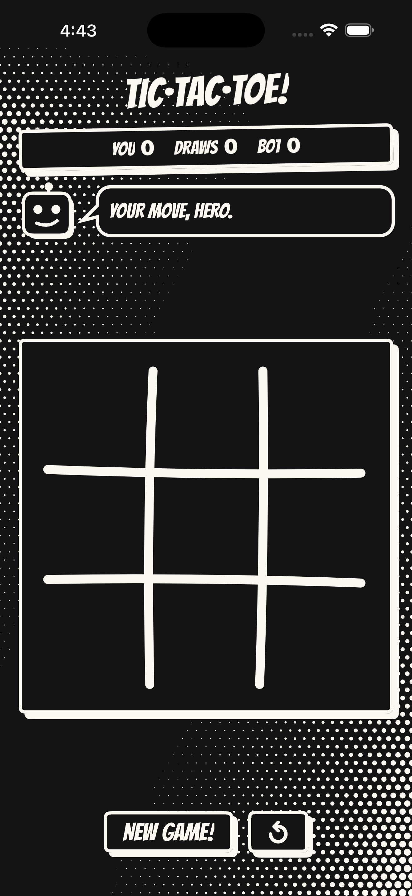
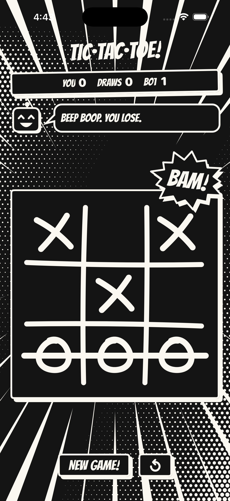
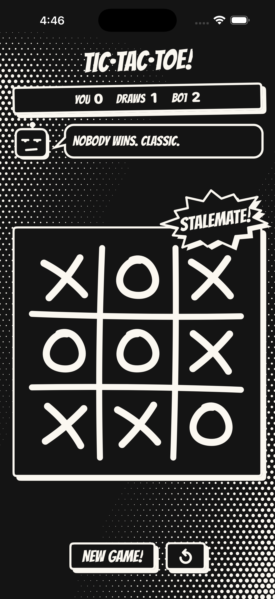
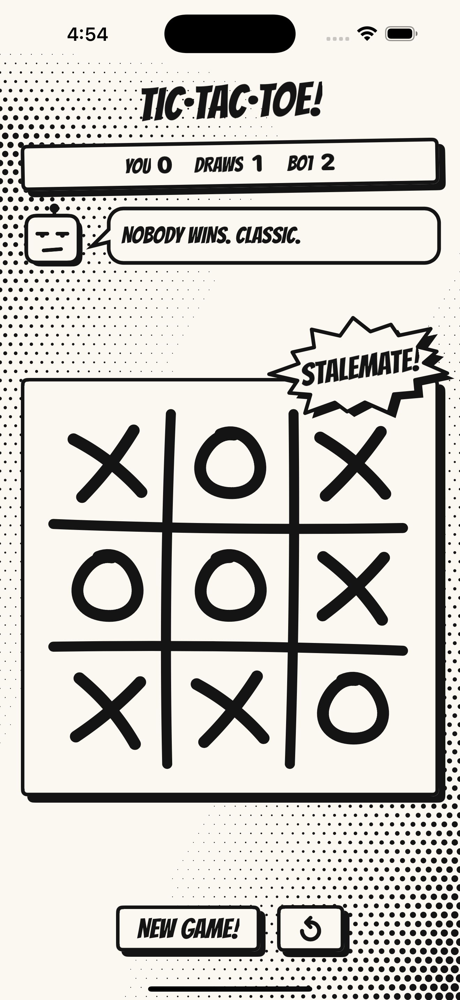

# Tic·Tac·Toe!

A one-player tic-tac-toe game for iPhone and iPad, drawn like a black-and-white comic book. You play X against a bot that is hard to beat, but not impossible.

<p align="center">
  
  
  
  
</p>

## Features

- **A hard bot.** It always takes a win and always blocks yours. Otherwise it plays the perfect minimax move, except that 10% of the time it plays a random move, so you can beat it.
- **Fair starts.** The first player alternates from game to game.
- **Your record is kept.** Wins, losses and draws are saved, and so is the game in progress: close the app mid-game and pick up where you left off. Starting a new game after you have moved counts as a loss.
- **Comic look.** Bangers lettering, halftone dots, speech bubbles and POW! bursts. Black ink on paper in light mode, swapped in dark mode.
- **Accessible.** It supports VoiceOver, Dynamic Type and Reduce Motion.
- **iPhone and iPad,** in portrait and landscape.

## Requirements

- Xcode 26
- iOS 26.0 or later

## Build and run

Open `TicTacToe.xcodeproj` in Xcode, choose the `TicTacToe` scheme and a simulator, and run. To run on a device, set your development team in the target's Signing settings.

There are no third-party dependencies.

## Tests

The 65 tests use Swift Testing. They cover:
- the rules;
- the bot, including an exhaustive proof that its engine never loses;
- the use cases and the save file;
- the view model and the app wiring.

```sh
xcodebuild test -project TicTacToe.xcodeproj -scheme TicTacToe \
  -destination 'platform=iOS Simulator,name=iPhone 17'
```

## Architecture

The code follows Clean Architecture, with one folder per layer in the app target:

```
Presentation/ ──▶ Domain/ ◀── Data/
       ▲             ▲           ▲
       └──── Application/ (composition root) ┘
```

| Folder | Contents |
|---|---|
| `TicTacToe/Domain` | Entities (`Board`, `Game`, `Match`, `Record`), use cases (load, play, bot move, new game, reset record), and the repository and bot interfaces. It uses no framework. |
| `TicTacToe/Data` | The file data source, the stored-format DTO, the mapper, and `DefaultMatchRepository`. |
| `TicTacToe/Presentation` | `GameViewModel`, which calls use cases only, and `GameViewState`. The SwiftUI views and the comic design system. Views never see domain types. |
| `TicTacToe/Application` | `AppDIContainer`, the only place that wires the layers together, and the `@main` app. |

The game is saved to `match.json` in Application Support as versioned JSON (schema v1). A file the app cannot read is set aside, never deleted.

More detail:
- the code map: [`docs/agent/CODEMAP.md`](docs/agent/CODEMAP.md);
- the design and its decisions: [`docs/agent/designs/tictactoe-app.md`](docs/agent/designs/tictactoe-app.md).

## Built with coding agents

This project uses [mobile-coding-agents](https://github.com/MarsXan/mobile-coding-agents) with Claude Code. `AGENTS.md` holds the project facts and working rules that agents follow.

## Credits

Lettering: [Bangers](https://github.com/googlefonts/bangers), Copyright 2010 The Bangers Project Authors. It is licensed under the SIL Open Font License 1.1; see [`TicTacToe/Resources/Fonts/Bangers-OFL.txt`](TicTacToe/Resources/Fonts/Bangers-OFL.txt).
